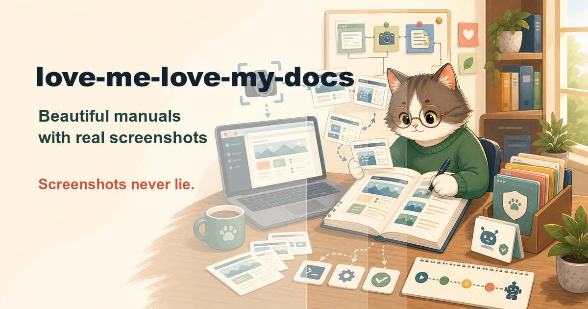

# love-me-love-my-docs

**Auto-generate a beautiful user manual whose captures never lie —
because they're produced by code, not pasted or imagined by hand.**

`love-me-love-my-docs` is an [agent skill](https://vercel.com/docs/agent-resources/skills)
for the manual nobody wants to write and everybody needs. Manuals rot for
one reason: screenshots are pasted, so the day the UI changes, every image
lies. This skill makes captures a **build artifact** — a committed capture
script walks the real app and records every step (screenshots on GUI
platforms, real command output for CLI) — so regenerating the entire
manual is one command, forever. And when the app can't run in the current
environment, it says exactly which parts stay unverified instead of
faking a capture.

## What it does

```
/love-me-love-my-docs . platform: web, output: mkdocs, language: th
```

1. **Flow census** — user journeys mined from routes, screens, or the
   command surface (`file:line` each), turned into a chapter plan you
   approve first.
2. **Demo data hygiene** — a seeded fictional account; **zero real user
   data in any frame or transcript** (captures outlive databases — treat
   every one as public forever). Mechanical production gate: the harness
   clicks real buttons and seeding writes real rows, so a non-localhost
   target requires explicit confirmation by hostname before a single row
   or click.
3. **Smoke capture first** — before any per-flow script exists, one real
   artifact is proven end-to-end (app boots, demo auth works, seed is
   visible, one image or transcript rendered into one chapter page).
   Operational surprises surface on flow 1, not flow 12.
4. **Capture harness** — the mechanism the platform actually has, never
   one tool forced onto every program:
   - **Web:** [Playwright](https://playwright.dev/python/) (Python):
     stored auth state, pinned viewport/theme, animation-freezing,
     target-element highlighting, per-locale runs, and a stable-selector
     policy (`get_by_test_id`/`get_by_role` only — bare text/CSS
     selectors are reported as app findings).
   - **Desktop:** OS-level screenshots (`screencapture`,
     `gnome-screenshot`/`maim`, PowerShell capture) plus GUI automation
     (AppleScript/`cliclick`, `xdotool`, `pyautogui`, accessibility
     APIs); Electron apps can often reuse the web harness. Window must be
     frontmost, fixed-size, unobstructed.
   - **Mobile:** [Maestro](https://maestro.dev/) — one YAML flow with
     `takeScreenshot` runs on iOS **and** Android; Fastlane
     snapshot/screengrab for store-screenshot sets. Installed only via
     auditable channels (package manager or pinned, inspected release —
     never `curl | bash`).
   - **CLI:** the capture IS the command — a committed script runs each
     documented command in a pinned environment (terminal width, `TERM`,
     locale, clean env) and saves real stdout/stderr/exit codes as
     transcripts; secrets and machine-specific noise are scrubbed by
     documented normalization rules.
   - Can't run the app here? Honesty mode: committed harness + a capture
     checklist + visible TODO placeholders, and a report listing exactly
     which flows stay unverified — never a faked capture.
5. **The manual** — chapter per flow: goal, prerequisites, numbered steps
   with one capture each and an expected result (captions say what to
   *notice*), result, troubleshooting from real failure modes. Written in
   user language — "click **Publish**", `git commit -m "…"` — never
   "trigger the endpoint". Agent scaffolding (seed scripts, auth state,
   dev-server boot) stays in `docs/capture/`, out of reader-facing steps.
6. **Beautiful output** — MkDocs Material by default (brand color pulled
   from the product's actual CSS), or plain Markdown, or PDF — one source,
   never forked per format.
7. **Freshness contract** — capture scripts are committed
   (`docs/capture/`); the manual documents its full regeneration chain
   (boot, seed, auth re-mint, capture); a mechanical rot pre-mortem
   (selectors, auth expiry, seed drift, pinned environment) plus a
   recommended CI job make a UI change that breaks capture fail loudly
   instead of letting the manual rot silently.

Bonus: steps the harness can't automate usually mean missing
`data-testid`s or accessibility labels — reported as app findings,
because they hurt real users and QA too, not just docs. A broken app is
a reported finding too: this skill documents software, it doesn't fix it.

## The skill family

| Skill | Moment |
|-------|--------|
| [know-my-repo](https://github.com/silkyland/know-my-repo) | Day one: onboard onto a repo with zero knowledge |
| [deep-plan](https://github.com/silkyland/deep-plan) | Plan the next feature/refactor — evidence-gated, 8 phases |
| [deep-plan-ingest](https://github.com/silkyland/deep-plan) | Distill an implemented plan into living knowledge files |
| [scaffold-my-plan](https://github.com/silkyland/scaffold-my-plan) | Turn a plan's first milestone into a running first slice |
| [clean-slate](https://github.com/silkyland/clean-slate) | Reset rotten knowledge files — backup-gated |
| [transform-my-repo](https://github.com/silkyland/transform-my-repo) | Change the architecture: migration feasibility + strategy |
| [reproduce-my-bug](https://github.com/silkyland/reproduce-my-bug) | Prove the bug before anyone fixes it |
| [audit-my-layout](https://github.com/silkyland/audit-my-layout) | Measure a live page's visual consistency, viewport by viewport |
| [ground-my-ui](https://github.com/silkyland/ground-my-ui) | Prove the UI's contracts before anyone redesigns |
| [ground-my-shopware](https://github.com/silkyland/ground-my-shopware) | Shopware 6 admin/storefront UI grounded in installed vendor source |
| [seed-ah](https://github.com/silkyland/seed-ah) | A world of ONE company that reads like it has been in use for a year |
| **love-me-love-my-docs** | A user manual that regenerates itself |

Shared law: **no claim without evidence** — here: no screenshot or
transcript without a script that reproduces it, no documented step that
wasn't actually performed.

## Install

```bash
npx skills add silkyland/love-me-love-my-docs
```

Or copy this directory into your agent's skills folder
(e.g. `~/.claude/skills/love-me-love-my-docs/`).

## Structure

```
love-me-love-my-docs/
├── SKILL.md                          # 8-step workflow + reproducibility rules
└── references/
    ├── capture-web.md                # Playwright (Python) harness patterns
    ├── capture-desktop.md            # OS-level screenshots + GUI automation; Electron note
    ├── capture-mobile.md             # Maestro flows + Fastlane/simctl/adb alternatives
    ├── capture-cli.md                # Real command runs → pinned-env transcripts
    └── manual-structure.md           # Manual anatomy, writing rules, MkDocs Material/PDF rendering
```

Follows the [Vercel skills](https://github.com/vercel-labs/skills) single-skill
layout and [Anthropic's skill authoring best practices](https://platform.claude.com/docs/en/agents-and-tools/agent-skills/best-practices).

## License

MIT
